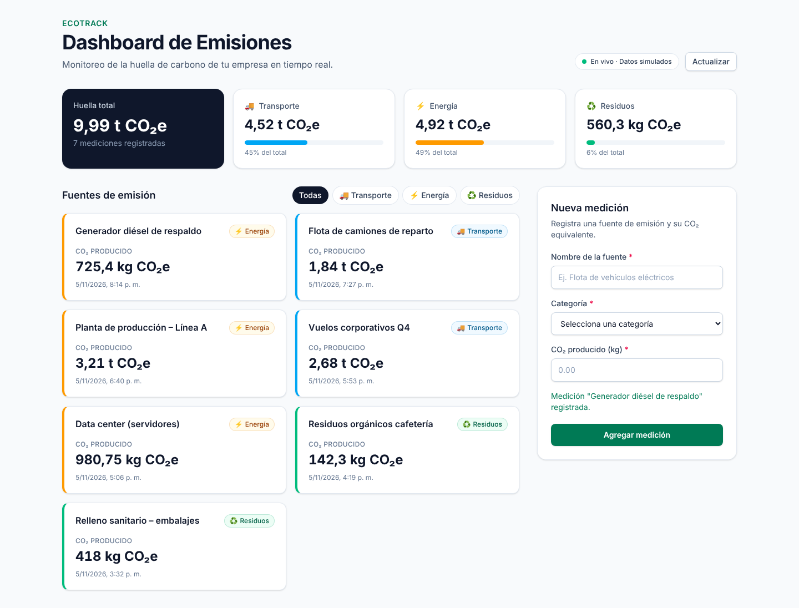

# EcoTrack · Dashboard de Emisiones en Tiempo Real

Componente `EmissionsTracker` (React + TypeScript + Tailwind) conectado a Supabase con un custom hook `useEmissions`.



## Entregables

| Entregable | Ubicación |
|------------|-----------|
| Bitácora de prompts | [`docs/BITACORA_PROMPTS.md`](docs/BITACORA_PROMPTS.md) |
| Componente | [`src/components/EmissionsTracker/EmissionsTracker.tsx`](src/components/EmissionsTracker/EmissionsTracker.tsx) |
| Hook | [`src/hooks/useEmissions.ts`](src/hooks/useEmissions.ts) |
| Configuración Supabase | [`src/lib/supabase.ts`](src/lib/supabase.ts), [`supabase/schema.sql`](supabase/schema.sql), [`.env.example`](.env.example) |
| Demo | [`docs/demo.mp4`](docs/demo.mp4) y [`docs/capturas/`](docs/capturas) |

## Ejecutar

```bash
npm install
npm run dev        # http://localhost:5173
```

Sin `.env.local` la app arranca con **datos simulados** (mismo contrato que Supabase, incluido el "tiempo real").

### Conectar Supabase

1. Crea un proyecto en [supabase.com](https://supabase.com).
2. En **SQL Editor** ejecuta `supabase/schema.sql` (tabla, RLS, Realtime y datos de ejemplo).
3. `cp .env.example .env.local` y completa `VITE_SUPABASE_URL` y `VITE_SUPABASE_ANON_KEY` (Project Settings → API).
4. `npm run dev` — el indicador de la cabecera cambia a **"En vivo · Supabase"**. Abre dos pestañas: lo que insertes en una aparece en la otra.

## Scripts

| Comando | Descripción |
|---------|-------------|
| `npm run dev` | Servidor de desarrollo |
| `npm run build` | Typecheck estricto + build de producción |
| `npm test` | Tests (Vitest + Testing Library) |

## Arquitectura

```
src/
├── types/emissions.ts               Tipos de dominio, tupla de categorías, mapper snake_case → camelCase
├── lib/supabase.ts                  Cliente singleton (null si no hay credenciales)
├── services/emissionsRepository.ts  Interfaz EmissionsRepository + implementación Supabase y Mock
├── hooks/useEmissions.ts            useReducer, AbortController, Realtime, totales memoizados
└── components/EmissionsTracker/
    ├── EmissionsTracker.tsx         Contenedor: resumen, filtros, listado, formulario
    ├── EmissionsSummary.tsx         KPIs por categoría
    ├── EmissionCard.tsx             Tarjeta (memo)
    ├── EmissionForm.tsx             Formulario accesible con validación
    └── categoryStyles.ts            Colores e Intl formatters
```

**Decisiones clave**

- **Separación lógica/UI**: los componentes no importan Supabase; todo pasa por `useEmissions` → `EmissionsRepository`.
- **Estados asíncronos**: carga (`idle/loading/success/error`) e inserción (`isSubmitting/submitError`) son independientes, así que un error al guardar no oculta la lista.
- **Tiempo real**: suscripción a `postgres_changes` (INSERT) con deduplicación por `id`.
- **TypeScript estricto**: `strict`, `noUncheckedIndexedAccess`, `exactOptionalPropertyTypes`; validación en tiempo de ejecución de las filas que llegan de Supabase.
- **Accesibilidad**: labels asociados, `aria-invalid`/`aria-describedby`, foco en el primer error, `role="alert"`/`status`, `aria-pressed` en filtros, `prefers-reduced-motion`.
- **Rendimiento**: `memo` en presentacionales, `useMemo` para totales y filtro, callbacks estables.
